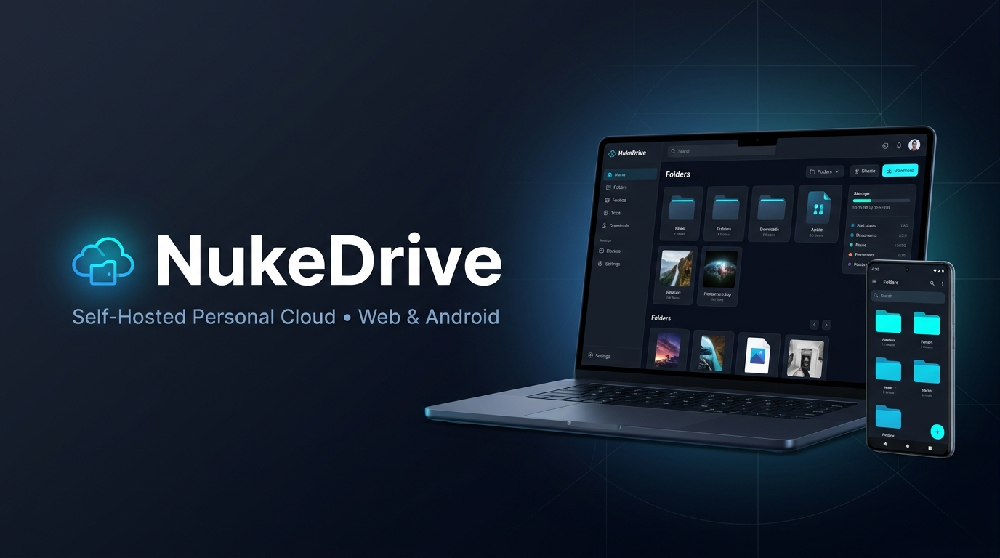

<p align="center">
  
</p>

# NukeDrive — Kendi Açık Kaynaklı Kişisel Bulutun (Self-Hosted Drive)

[](LICENSE)
[](#neden-nukedrive)
[](#neden-nukedrive)

> Kurulum ve detaylı yayın rehberi: [KURULUM.md](KURULUM.md) · Lisans: [MIT](LICENSE)

**NukeDrive**, kendi bilgisayarınızda çalışan, **tek tıkla kurulabilen**, **kullanıcı dostu** ve **tamamen açık kaynaklı** kişisel bulut ve dosya yönetim sistemidir. Google Drive benzeri modern arayüzü sayesinde dosyalarınızı bulut şirketlerine emanet etmeden kendi cihazınızda saklayabilir; hem **Web Tarayıcısından**, hem **Masaüstü Uygulamasından**, hem de **Android Uygulamasından (`NukeDrive.apk`)** her yerden güvenle erişebilirsiniz.

## Neden NukeDrive?

- **Tek Tıkla Kurulum:** Teknik bilgi veya komut satırı gerektirmez. Windows kurulum dosyasını (`NukeDrive Setup`) indirip tek tıkla kurabilir ya da `BASLAT.bat` ile anında çalıştırabilirsiniz.
- **Kendi Drive'ın, Tam Gizlilik:** Tüm dosyalarınız ve veritabanınız yalnızca sizin bilgisayarınızda tutulur. Üçüncü parti bulut abonelikleri, depolama sınırları veya gizlilik endişeleri yoktur.
- **Kullanıcı Dostu Arayüz:** Google Drive'a alışkın herkesin saniyeler içinde kullanabileceği sade, hızlı ve dokunmatik ekranlarla uyumlu modern tasarım.
- **Android Uygulaması (`NukeDrive.apk`):** Telefonunuzdan dosyalarınıza erişin, fotoğraf/video/belge yükleyin, önizleyin ve paylaşın.
- **Tek Tıkla İnternete Açma (Ücretsiz HTTPS):** Modemden port açmanıza gerek kalmadan **Cloudflare Tunnel** ile tek tıkla `https://...` adresi üzerinden dış dünyaya güvenle bağlanın (ister ücretsiz hızlı tünel, ister kendi alan adınız).

## Temel Özellikler

- **Kullanıcı Adı ve Şifre ile Giriş:** E-posta zorunluluğu olmadan doğrudan belirlediğiniz kullanıcı adı ve şifre ile giriş.
- **Yabancı Kayıt Koruması:** Siteniz internete açıkken dışarıdan kimse kayıt olamaz; yalnızca sizin izin verdiğiniz hesaplar giriş yapabilir.
- **Dışarıya Yayın Seçenekleri:**
  - **Ücretsiz Hızlı Tünel (`*.trycloudflare.com`):** Alan adı veya modem port yönlendirmesi gerekmeden tek tıkla HTTPS internet yayını.
  - **Kendi Alan Adınız (Cloudflare Tunnel Token):** Kendi web siteniz (ör. `https://drive.alanadiniz.com`) üzerinden kalıcı yayın.
  - **Yerel Ağ (Wi-Fi):** Ev/ofis içinde `http://192.168.x.x:4000` üzerinden yüksek hızlı doğrudan erişim.
- **Gelişmiş Drive Kuralları:**
  - **Çakışma Kuralı:** Aynı isimli dosya yüklendiğinde otomatik numaralandırma (`dosya (1).ext`), üzerine yazma veya reddetme.
  - **Depolama Kotası & Yükleme Sınırı:** Kullanıcı başına kota (MB/GB veya sınırsız) ve maksimum dosya boyutu kuralı.
  - **Çöp Kutusu Kuralı:** Silinen dosyaları belirlenen gün sonunda (varsayılan 30 gün) otomatik temizleme.
  - **Uzantı Güvenlik Kuralı:** İstenmeyen dosya uzantılarını engelleme.
- **Tam Dosya Yönetimi & Önizleme:**
  - Resim, Video (ileri/geri sarma destekli), Ses, PDF ve Metin/Kod dosyalarını indirmeden uygulama içinde **Önizleme (Preview)**.
  - Klasörlere tek tıkla / dokunarak girme (Android dokunmatik ekranlarla tam uyumlu).
  - Dosya ve klasör yükleme (canlı `%` ilerleme çubuğu ile), yeniden adlandırma, klasöre taşıma, kopyalama, yıldızlama (favoriler) ve çoklu seçim (toplu işlem).
  - **Şifreli ve Süreli Paylaşım Linkleri:** Paylaştığınız dosya/klasörlere isteğe bağlı **şifre** ve **geçerlilik süresi** koyabilme, aktif paylaşımları tek tıkla iptal edebilme.

## Tek Tıkla Kurulum ve Başlatma (Windows)

### Yöntem 1: Masaüstü Kurulum Dosyası (Önerilen)
1. **Releases** sayfasından `NukeDrive Setup` kurulum dosyasını indirip çalıştırın (Node.js veya ek kurulum gerekmez).
2. İlk açılışta gelen **Kurulum ve Ayarlar** penceresinden yönetici hesabınızı oluşturun ve dilerseniz tek tıkla internete açın.
3. Pencereyi kapatsanız bile uygulama sistem tepsisinde çalışmaya devam eder.

### Yöntem 2: Kaynak Koddan Hızlı Başlatma
1. Proje klasöründeki **[BASLAT.bat](BASLAT.bat)** dosyasına çift tıklayın.
2. Tarayıcıda otomatik olarak `http://localhost:4000` açılır.
3. İlk açılışta hesabınızı oluşturun veya varsayılan bilgilerle giriş yapıp **Hesap & Şifre Ayarları** bölümünden bilgilerinizi güncelleyin.
4. Dışarıya yayın yapmak için **Dış Yayın & Android** menüsünden **Ücretsiz Hızlı İnternet Yayını** veya **Kendi Web Siteniz (Token)** seçeneğini aktif edin.
5. Ekranda oluşan `https://...` adresini hem tarayıcınızdan hem de **Android uygulamanızdan (`NukeDrive.apk`)** sunucu adresi olarak girip bağlanın!

## Geliştiriciler İçin (Komut Satırı)

```bash
# Bağımlılıkları yükle
npm install

# Sunucuyu ve Web arayüzünü derle
npm run build:server
npm run build:web

# Sunucuyu başlat (http://localhost:4000)
npm start --workspace apps/server
```

Masaüstü uygulaması ve Android APK derlemek için:

```bash
npm run build:desktop
```

## Katkıda Bulunma

NukeDrive açık kaynaklı bir projedir. Hata bildirimleri (Issue), özellik önerileri ve Pull Request'ler memnuniyetle karşılanır!

## Lisans

Bu proje [MIT Lisansı](LICENSE) ile lisanslanmıştır.
